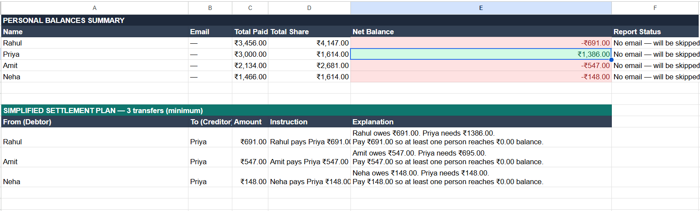
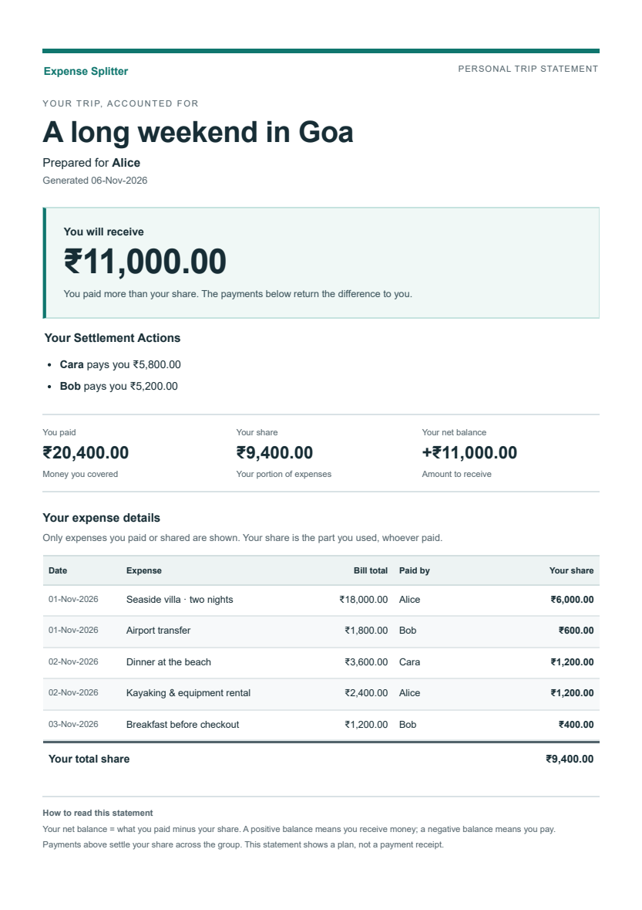

<div align="center">

# ✈️ Dynamic Group Travel Expense Splitter

**A zero-dependency, open-source Splitwise alternative built directly inside Google Sheets.**
Per-person splits, exact minimum-transfer settlements, and personalized PDF email reports. An optional mobile workbook adds guided entry, budget charts, validation, and versioned recovery.

[](#quick-start)
[](#quick-start)
[](LICENSE)
[](#contributing)

<br />

<a href="#quick-start">
  
</a>

<br /><br />

[**🚀 Click Here to Make a Copy in Google Drive**](https://docs.google.com/spreadsheets/d/1RhpHiZl04dA-AfKIuFesJz137zO-eatgfG5TYGRXXJM/copy)
*(No installation required for non-technical users)*

</div>

---

## Contents

- [Key features](#features)
- [Tech stack](#tech-stack)
- [Prerequisites](#prerequisites)
- [Screenshots](#screenshots)
- [Quick start](#quick-start)
- [Classic workbook tabs](#classic-workbook-tabs)
- [Calculations, splits, currency, and settlements](#calculations)
- [Desktop menu reference](#menu-reference)
- [Mobile workbook upgrade](#mobile-workbook-upgrade)
- [Local development with clasp](#local-development-with-clasp)
- [Architecture](#architecture)
- [Configuration and environment](#configuration-and-environment)
- [PDF design](#participant-pdf-design)
- [Testing](#testing)
- [Deployment and release](#deployment-and-release)
- [Troubleshooting](#troubleshooting)
- [Documentation](#documentation)
- [Contributing](#contributing)
- [License](#license)

The workflows and screenshots below describe the classic layout. The optional [mobile workbook upgrade](#mobile-workbook-upgrade) adds guided entry, budgets/charts, validation warnings, and versioned recovery without resetting existing trip inputs.

<a id="features"></a>

## 🌟 Why Use This Over Splitwise?

* **Self-Hosted in Google Sheets:** No application subscription or ads. Supports up to 15 people and 500 expense rows per tracker; Google service quotas still apply.
* **Live Calculations:** Per-person net columns update on expense edits. Local expenses need no API call; foreign rates are fetched on the first lookup and reused for 24 hours.
* **Flexible Splits:** Use positional exact amounts, named percentages, or equal shares in the same Split Among cell.
* **Historical Currency Conversion:** Blank row currencies inherit the trip base currency. Override with an ISO code to convert using the transaction date.
* **Live Summary Panel:** **Send Reports!H:K** always shows total group spending, each person's paid amount, consumed share, and net balance. It updates while editing expenses, even before confirmation.
* **Exact Settlement Engine:** On confirmation, uses subset dynamic programming to find the fewest possible transfers for up to 15 people. Every settlement row explains the outstanding debt, credit, and payment amount.
* **Automated PDF Email Statements:** Generates clean, personalized HTML/PDF expense reports — each person receives only the expenses that involve them — dispatched via Gmail in one click.
* **Dynamic Roster Scaling:** Scale your group seamlessly from 2 to 15 people — the grid, dropdowns, person columns, and summary panel auto-adjust on the fly.
* **Mobile Editing & Confirmation:** Enter expenses and confirm setup through checkboxes in the Sheets app. Send PDF emails from the desktop menu or Apps Script editor.
* **Reusable Trip Records:** Save complete trip inputs as JSON, download a portable file, reload past trips, and start a blank trip in the same spreadsheet.
* **Optional Mobile Workbook:** Owner-enabled upgrade with participant entry blocks, reusable templates, expense copying, category/trip budgets, spending charts, duplicate checks, and the latest 20 recovery versions per trip. See [activation and verification status](#mobile-workbook-upgrade).

## Tech Stack

| Component | Implementation |
| --- | --- |
| Runtime | Google Apps Script V8; source in [Code.js](Code.js) |
| Interface and storage | Bound Google Sheets workbook, cell controls, dropdowns, charts, Records, and optional recovery state |
| Browser dialog | [TripJson.html](TripJson.html), served by Apps Script HtmlService for JSON import/download |
| Money and settlements | Integer minor units; exact subset dynamic programming for up to 15 people; whole-unit payment output |
| Historical exchange rates | Frankfurter v2 requests through UrlFetchApp, with document properties and CacheService |
| PDF and email | Apps Script HtmlService conversion and MailApp |
| Local verification | Node.js 22+ built-in test runner, VM, and built-in modules; no npm dependencies |
| Upload tooling | Optional Google clasp CLI; optional Git pre-push synchronization |

There is no local web server, package manifest, external database, container, or application build step. Uploads update a spreadsheet-bound Apps Script project; they do not deploy a standalone website.

## Prerequisites

For using the tracker, you need a Google account, edit access to your spreadsheet copy, and desktop Google Sheets for initial setup/authorization. Android or iPhone Sheets apps support the daily mobile workflow after setup. Scripted actions need connectivity; a pending draft is not a confirmed expense.

For local development, install Node.js 22 or newer and Git. The full test suite also uses Git for Windows Bash at `C:\Program Files\Git\bin\bash.exe` on Windows, or `/bin/bash` elsewhere. Install clasp only if you will upload code. Local tests require no Google credentials or email access.

---

<a id="screenshots"></a>

## 📸 Screenshots & Workflow

### 1. Trip & Roster Setup


### 2. Expense Tracker


*Sheet screenshots show the previous layout. The current version adds Currency in **Expenses!F**, starts participant outputs at **G**, and keeps the live summary in **Send Reports!H:K**.*

### 3. Simplified Settlements



### 4. Generated Participant PDF

<table width="100%">
  <tr>
    <td width="50%" align="center" valign="top">
      <b>Receive money</b><br /><br />
      <a href="assets/pdf-report.png"></a>
    </td>
    <td width="50%" align="center" valign="top">
      <b>Pay money</b><br /><br />
      <a href="assets/pdf-report-pay.png"></a>
    </td>
  </tr>
  <tr>
    <td width="50%" align="center" valign="top">
      <b>All settled</b><br /><br />
      <a href="assets/pdf-report-settled.png"></a>
    </td>
    <td width="50%" align="center" valign="top">
      <b>Long statement — first page</b><br /><br />
      <a href="assets/pdf-report-long.png"></a>
    </td>
  </tr>
</table>

*PNG screenshots from the rendered [test previews](tests/preview-pdf.cjs), using fictional trip data. Click any image to view it at full size.*

---

<a id="quick-start"></a>

## ⚡ Quick Start

Use a Google account with permission to edit your own spreadsheet copy. Node.js and clasp are only needed for local development.

**Initialize only on a fresh copy:** `setup()` / `1. Initialize / Reset Tracker` clears the **Setup**, **Expenses**, and **Send Reports** sheets. Updating script code does not require running initialization again.

Saved **Records** survive initialization. Use **New Trip** for the next journey: it saves current inputs before clearing the active trip. After installing this update, reload the spreadsheet to add Records and the Save Trip checkbox without resetting existing inputs.

### Option A: 1-Click Google Sheet Template (Easiest)

1. Click the **[Make a Copy Template Link](https://docs.google.com/spreadsheets/d/1RhpHiZl04dA-AfKIuFesJz137zO-eatgfG5TYGRXXJM/copy)**.
2. Open the newly created spreadsheet in your Google Drive.
3. Reload the spreadsheet to load the **Expense Splitter** menu, then select `1. Initialize / Reset Tracker` on the fresh copy.
4. Authorize the script when prompted, then follow **Daily workflow** below. If the menu is missing, open **Extensions → Apps Script** and run `setup()` once.

### Option B: Manual Setup via Google Apps Script

1. Create a blank **Google Sheet**.
2. Navigate to **Extensions** → **Apps Script**.
3. Replace all content in `Code.gs` with the code from [`Code.js`](Code.js).
   Add an HTML file named `TripJson` in Apps Script and copy [`TripJson.html`](TripJson.html) into it for JSON downloads and imports.
4. In Apps Script **Project Settings**, enable the manifest editor and copy [`appsscript.json`](appsscript.json) into the project's `appsscript.json` to match the V8 runtime. The manifest uses UTC as a neutral script default; trip dates and reports use the timezone selected in Setup.
5. Save, select `setup` in the function dropdown, and click **Run** to initialize the blank sheet and authorize the script.
6. Reload Google Sheets to load the **Expense Splitter** menu, then follow the workflow below.

### Daily workflow — classic workbook

1. Fill in the trip name, participant count, base currency, timezone in **Setup!E4**, and unique participant names on **Setup**. Emails are optional. Use names without commas so subgroup selections remain unambiguous.
2. Select **Expense Splitter → Confirm / Update Setup**, or tick `Setup!B6` / `Setup!B7` on mobile.

    Adding names below the active roster automatically raises **Number of People**, up to 15. You can also change `Setup!B3` directly. Reducing the count deactivates extra rows but preserves their names and emails; raising it restores those entries.
3. Enter expenses in **Expenses!A2:F501**. Choose a payer and a [split](#three-split-modes). Leave Currency blank for the base currency. For foreign expenses, first select **Enable Automatic Currency Conversion** from the desktop menu and authorize once; then enter the transaction date and an ISO code in F.
4. When ready to review, select **Confirm All Expenses** and open **Send Reports**. On mobile, tick `Setup!B6`; if already checked, clear it and tick it again to refresh.
5. To send statements, use **3. Send PDF Reports via Email** on desktop and grant email permission if requested. Review delivery status in **Send Reports**.
6. Save the completed trip with **Save Trip** or the `Setup!E6` checkbox. Use **New Trip** to reuse this spreadsheet.

Confirmation is a report-visibility gate, not an edit lock: classic expense edits continue to recalculate the plan. Changing setup details resets confirmation. In the upgraded workbook, expense edits also withdraw confirmation; incomplete rows and unacknowledged duplicates must be resolved before confirming again. After renaming or removing participants, update their names in existing **Paid By** and **Split Among** entries before reconfirming.

---

## Classic Workbook Tabs

The classic workbook has four tabs. The optional upgrade retains them and adds Dashboard, Quick Entry, Budgets, History, and the internal _Tracker State sheet.

### 1️⃣ Setup

Configure the trip and the group:

| Cell | Setting | Default |
|------|---------|---------|
| `Setup!B2` | Trip Name / Destination | Goa Vacation 2026 |
| `Setup!B3` | Number of Participants (dropdown 2–15) | 4 |
| `Setup!B4` | Base currency: ISO code or supported symbol | ₹ (INR) |
| `Setup!B5` | Setup Status (auto-validated) | — |
| `Setup!B6` | **Setup Confirmed?** checkbox; also gates settlement/report output | ☐ FALSE |
| `Setup!B7` | **Confirm / Update Setup** checkbox action; resets after use | ☐ FALSE |
| `Setup!E6` | **Save Trip** checkbox action; saves a complete JSON snapshot in Records and resets after use | ☐ FALSE |
| `Setup!E3` | Current trip ID; maintained by the script to update the same archive on repeated saves | — |
| `Setup!E4` | Timezone dropdown; also accepts other supported timezone names | Current spreadsheet timezone |
| `Setup!A9:C…` | Roster: `#` · `Name` · `Email (optional)` — rows scale with B3 | — |

> Emails are **optional** — only people with an email address receive PDF reports; everyone else is cleanly skipped and logged.

Choose **Setup!E4** on desktop or mobile. Suggestions cover common timezones; type another supported name such as `America/Argentina/Buenos_Aires` when needed. The selection updates the [spreadsheet timezone](https://developers.google.com/apps-script/reference/spreadsheet/spreadsheet#setSpreadsheetTimeZone(String)) for all collaborators. Existing expense calendar dates remain unchanged, including across daylight saving offsets. FX dates, report dates, and delivery timestamps follow the selected timezone. Invalid selections restore the previous setting. Changing timezone requires setup confirmation again. Initialization and New Trip keep the current spreadsheet timezone. Reloading an existing tracker adds this control without clearing inputs.

### 2️⃣ Expenses

In the classic layout, enter expenses in columns **A–F**; everything else is computed live. The optional mobile upgrade below adds Category in G, a hidden ID in H, and starts participant outputs at I.

| Column | Field | Type |
|--------|-------|------|
| A | Date | Date-validated (dd-mmm-yyyy) |
| B | Description | Free text |
| C | Amount | Positive amount in the row currency; up to two decimal places |
| D | Paid By | Dropdown, auto-filled from roster |
| E | Split Among | Exact amounts, named percentages, `All`, blank, or comma-separated names |
| F | Currency | Blank inherits Setup!B4; use an ISO code for an override |
| G+ | *One column per person* | Net in base currency: amount paid minus personal share; + collect / − owe |

The live summary is in **Send Reports!H:K**. Expenses contains input columns A:F and participant net columns from G onward. Recalculation or setup confirmation upgrades older trackers automatically: A:E inputs survive, the former generated F output becomes blank Currency input, and participant outputs are rebuilt from G. Later rebuilds preserve F currencies.

**LIVE SUMMARY example (Send Reports):** Priya pays a ₹10,000 bill split equally among four people. Total Spent (Everyone) is ₹10,000:

| Person | Paid | Spent (Share) | Net (+ collect / − owe) |
|--------|-----:|--------------:|-----------------------:|
| Rahul | ₹0 | ₹2,500 | −₹2,500 |
| Priya | ₹10,000 | ₹2,500 | +₹7,500 |
| Amit | ₹0 | ₹2,500 | −₹2,500 |
| Neha | ₹0 | ₹2,500 | −₹2,500 |

**Duo example:** if Person 2 pays a ₹1,000 hotel bill split between both, the summary shows **Spent ₹500** for each person. Person 1's net is **−₹500** and Person 2's net is **+₹500**. The generated expense-row columns show those signed nets, not the ₹500 shares.

### 3️⃣ Send Reports

The live summary in **H:K** is always available and recalculates on expense edits. The report and settlement tables in **A:F** require `Setup!B6` (**Setup Confirmed?**) to be checked. Use **Confirm All Expenses** to refresh the report after reviewing expenses. It shows:

* **Personal Balances Summary** — per-person Total Paid, Total Share, Net Balance, and email delivery status.
* **Simplified Settlement Plan** — the minimum set of "X pays Y ₹amount" transactions that settles the whole group.

### 4️⃣ Records

Each saved trip occupies one row. Columns A:E show the trip ID, name, UTC save time, number of nonempty expense input rows, and JSON part count. JSON occupies F onward in parts of at most 40,000 characters, each prefixed `JSON:`. Large trips therefore fit across multiple cells. Keep archive cells and the current trip ID unchanged; use the menu to manage records.

- **Save:** select **Expense Splitter → Save Trip**, or tick `Setup!E6`. Saving again updates the current trip's existing archive, including after loading that trip. Saves are manual snapshots; individual edits do not automatically update Records.
- **Load:** select a cell in one saved trip's Records row, then choose **Load Selected Trip**. Current inputs are saved before the selected trip replaces them. Expense columns, summaries, and settlement plans are rebuilt without sending email.
- **Download:** select a saved trip row and choose **Download Selected Trip JSON**, then click the download link. This creates one `.json` file on your device. Save current changes first if you want them in the file.
- **Import:** choose **Import Trip JSON**, select a downloaded file, and confirm **Import and load trip**. The file receives a new trip ID, current inputs are saved, and the imported trip is loaded and added to Records.
- **Delete:** select a saved trip row and choose **Delete Selected Trip**. Confirm to remove only that archive. Active inputs and downloaded files remain available; saving active inputs again creates a new archive if its record was deleted.
- **New trip:** choose **New Trip** and confirm. Current inputs are saved first; trip name, participant names, expenses, and confirmation are cleared. The blank canvas starts with two participant slots and ₹ currency. Saved Records remain available.

Classic snapshots include trip name, base currency, participant count, all 15 roster slots (including inactive names and emails), confirmation, and all 500 supported expense input rows in A:F. Upgraded snapshots additionally include Category, Expense ID, and workbook configuration in schema version 3. Draft entries, interior blank rows, all split modes, row currencies, and actual date values survive a round trip. Only trailing empty rows are omitted. Formulas are saved as their current values. Version 1 files load with inherited currencies; version 2 includes row currencies. Derived output is recalculated on load; FX cache entries and email delivery statuses are not exported. Loading historical trips can therefore fetch rates again.

Incomplete names and draft expenses can be saved. Portable Records still require a participant count of 2–15. Invalid or unsupported JSON is rejected before replacing inputs. **Classic loading** requires the same spreadsheet timezone as the saved trip; select it in **Setup!E4** first. **Upgraded loading** applies the saved timezone during checkpointed replacement and returns unconfirmed inputs. A classic workbook must be upgraded before loading version 3 JSON. JSON contains participant emails and expense details, so share files with the same care as the spreadsheet.

Deleting the active trip's Records row also clears its current trip ID. In an upgraded workbook, budgets, templates, and recovery history remain associated with the former ID; a newly allocated ID uses default configuration. Keep a JSON export or use **History!B3** to select the previous trip when those settings need to be restored. Deleting a Records row does not delete History versions.

On mobile, `Setup!E6` saves to Records. File download/import and record-management menu actions use desktop Google Sheets. JSON files download through the browser; no Drive file or email is created.

---

<a id="calculations"></a>

## ⚙️ How It Works

### Supported inputs & delivery

- Supports **2–15 participants** and **500 expense rows**, starting at row 2. Rows after 501 are not included in calculations.
- Enter positive amounts with up to two decimal places. Classic calculations ignore empty/incomplete rows and non-positive or non-numeric amounts. Upgraded calculations retain nonempty invalid rows with warnings, label partial totals, and block confirmation. Completely blank rows remain unused. Refunds and negative expenses are not supported.
- Names match without case sensitivity or surrounding spaces. Duplicate equal-split names count once. Unknown names and duplicate percentage entries produce row errors and block settlement and PDF sending.
- All currencies currently use two decimal places for ledger units, including codes whose standard minor-unit precision differs. Use ISO codes for ambiguous symbols; `$` means USD.
- Sending reports is manual. Missing or invalid email addresses are skipped. Running the send action again sends another email to every valid address, including participants already marked **Sent**.
- PDF conversion and email sending use your Google account's [Apps Script quotas](https://developers.google.com/apps-script/guides/services/quotas).

<a id="three-split-modes"></a>

### Three Split Modes

All three modes use **Expenses!E**, with no separate split columns:

* **Positional exact:** `400, 500, 100` charges roster positions 1, 2, and 3 those amounts. Remaining people receive zero shares. Enter amounts in the row currency; their sum must match C before conversion. A mismatch produces `Row X: Exact split total (1000) does not match total bill (1200)`. More amounts than active roster members are rejected. Roster reordering changes positional assignments.
* **Named percentages:** `Rahul 30, Neha 40, Amit 30` assigns 30%, 40%, and 30%. An optional `%` suffix and up to four decimal places are supported. Percentages must be nonnegative and sum to exactly 100%; otherwise, for example, `Row X: Split percentages total 90%, must equal 100%`. Unlisted people receive zero shares.
* **"All" or blank Split Among:** cost splits equally across the whole roster.
* **Comma-separated names** (`Rahul, Neha`): cost splits only within that subgroup.
* **Exclude names** (`-Amit` or `-Amit, -Neha`): cost splits equally among everyone else. Excluded people receive zero expense shares. Names ignore case and surrounding spaces; repeated exclusions count once. Prefix every excluded name with `-`; do not mix exclusions with names, amounts, or percentages. Unknown names and excluding the entire roster produce row errors. If an excluded person paid the bill, their payment still counts toward their net balance.
* **Remainder handling:** percentage and equal shares round down to minor units, then distribute leftover units by ascending participant ID among people with a positive share. Exact foreign splits preserve the entered proportions after conversion and reconcile the same way. Allocations always equal the converted bill, and group balances sum to zero. Zero-weight participants never receive a remainder.

### Historical FX Conversion

Set **Setup!B4** to an ISO code such as `INR`, `USD`, `EUR`, `GBP`, or `THB`. Supported symbol aliases are `₹`, `$`, `€`, `£`, and `฿`, respectively. Blank row currencies inherit B4, and explicit matches to the base currency bypass FX services entirely. Other custom display symbols continue to work for local-only trips; foreign conversion requires a recognized base symbol or ISO code.

For a foreign expense, enter its original amount in C, transaction date in A, and currency code in F. Codes match without case sensitivity. RoamTab queries the [Frankfurter v2 historical pair endpoint](https://frankfurter.dev/) using the spreadsheet's calendar date and converts into the base currency before allocating shares. API calls require no key or external package. The first lookup requires a network request; repeated rows with the same pair and date share one request per recalculation. Frankfurter may return an earlier available observation on non-publication days; RoamTab accepts it and never substitutes a latest-rate request. Missing, invalid, future, or unavailable foreign dates and unsupported pairs produce row errors instead of an assumed rate.

Rates use keys such as `FX_USD_INR_2026-01-09`. [CacheService permits at most six hours](https://developers.google.com/apps-script/reference/cache/cache), so document properties retain each rate with a fixed 24-hour expiry. Cache misses repopulate from that backing without another API request. Expired backing entries are removed during fresh fetches. Decimal-rate conversion rounds once to base minor units before any split; totals, settlements, and PDF amounts all use the base currency.

Choose **Expense Splitter → Enable Automatic Currency Conversion** once from desktop Google Sheets and grant the requested permissions. This installs an authorized edit trigger because [simple triggers cannot call services requiring authorization](https://developers.google.com/apps-script/guides/triggers). One designated account should enable it for the spreadsheet; that account owns the trigger and consumes its fetch quota. Once enabled, edits from mobile also recalculate automatically. Repeating the action from the same account repairs a deleted trigger without creating duplicates. If the trigger owner loses access or authorization, use the menu action again from the designated account. Without an installed trigger, local rows and warm cached FX rates still recalculate; uncached foreign rows show an actionable error. **2. Recalculate Live Expenses** can fetch rates manually after authorization.

Split and FX errors appear in **Send Reports!A1** even before confirmation. Invalid rows are excluded from live totals, and settlement/PDF sending remains blocked until all errors are resolved.

### Settlement Engine (Exact Minimum Transfers)

Payments use **whole currency units** with ordinary nearest-number rounding: ₹455.76 becomes ₹456, ₹455.23 becomes ₹455, and ₹455.50 becomes ₹456. Payments below half a unit round to zero and disappear. The engine first calculates the exact plan, rounds each payment once for both parties, and rebuilds their payment balances. It then finds the minimum transfer count for those rounded balances. Debtors and creditors always agree on each payment, and the rounded group balances still sum to zero. When someone has several payments, their net balance is the sum of those rounded payments.

Expense inputs, FX conversion, shares, and saved JSON retain integer minor-unit precision. Calculated sheet cells and PDF amounts display without decimals. Paid/share totals keep their exact stored values; the live summary and report net balances include payment rounding. Rounded displayed expense rows may therefore differ from displayed totals. Sheet instructions and PDF instructions use the same whole-unit plan.

The solver finds the largest number of independent groups whose net balances sum to zero. It then settles each group separately. If there are `n` people with nonzero balances and `g` groups, the minimum number of transfers is `n - g`.

```
Net balances → optimal independent groups → payments within each group
             → verify minimum transfer count and zero remaining balances
```

For debts of ₹8, ₹7, and ₹5 with credits of ₹12 and ₹8, the solver finds two groups: `(−₹8, +₹8)` and `(−₹7, −₹5, +₹12)`. It generates three transfers instead of the four produced by ungrouped greedy matching. The existing greedy helper is used only inside optimal groups, where it produces the required minimum.

The **Explanation** column beside each payment uses this template: “[Person A] owes ₹X. [Person B] needs ₹Y. Pay ₹[smaller of X or Y] so at least one person reaches ₹0 balance.” Names, outstanding amounts, and currency come from the actual payment plan. Payment order is deterministic, and PDF payment instructions use the same plan.

The exact solver uses `O(n × 2^n)` time and `O(2^n)` memory, with at most 32,768 subsets for 15 people. It blocks invalid balances, unsafe integer totals, and groups above the supported limit. It never substitutes an approximate plan. See the [design and decision log](docs/plans/optimal-settlements.md).

### Performance Design

* Expense inputs are read as a range and calculated in memory; participant results and summary rows are written in batches.
* Structural rebuilds (headers, dropdowns, validations) happen **only** on Setup/roster changes, never while typing expenses.
* Send Reports refreshes on expense edits and setup changes. The live summary remains visible while settlement output is unconfirmed.
* UI messages fall back from alerts to toasts or logs when dialogs are unavailable.

---

<a id="menu-reference"></a>

## 🧰 Menu Reference (Desktop)

| Menu Item | Action |
|-----------|--------|
| `Upgrade / Repair Mobile Workbook` | Owner-only, checkpointed upgrade; retains classic inputs/Records and installs automation; repairs an existing upgraded layout |
| `Repair Workbook Automation` | Owner installs/repairs the authorized dispatcher and reconciles pending mobile requests |
| `Recover Interrupted Workbook Operation` | Owner rolls back unverified replacement or finishes verified-operation cleanup while preserving original protections |
| `1. Initialize / Reset Tracker` | Classic: clears/rebuilds active tracker sheets and preserves Records. Upgraded: uses the checkpointed New Trip flow |
| `2. Recalculate Live Expenses` | Recalculates expense nets and Send Reports live summary; settlement output requires confirmation |
| `Enable Automatic Currency Conversion` | Classic: installs the FX trigger. Upgraded: repairs the owner-run workbook automation |
| `Confirm / Update Setup` | Classic: validates/rebuilds the roster and confirms setup. Upgraded: also checks expense errors and duplicate acknowledgement |
| `Confirm All Expenses` | Validates and publishes balances/settlements; upgraded incomplete rows and unacknowledged duplicates block confirmation |
| `Re-open for Editing (Unconfirm)` | Withdraws the report view |
| `Save Trip` | Saves/updates Records; upgraded workbooks first create a recovery version |
| `Load Selected Trip` | Saves current inputs, then loads the selected Records row |
| `Download Selected Trip JSON` | Opens a download link for the selected saved trip |
| `Import Trip JSON` | Saves current inputs, then loads and archives an exported JSON file with a new ID |
| `Delete Selected Trip` | Deletes the selected archive after confirmation; keeps active inputs |
| `New Trip` | Saves current inputs, then creates a blank trip while keeping Records |
| `3. Send PDF Reports via Email` | Emails personalized PDF statements to roster emails |
| `Test Email Permission` | Sends a test mail to verify the send-mail authorization |
| `Diagnose Settlement Data` | Shows roster, ledger errors, balance checks, and settlement rows |

> **Mobile users:** use `Setup!B6` or `Setup!B7` for confirmation and `Setup!E6` to save a trip. Email sending uses the desktop menu or the `sendPdfReports()` function in Apps Script.

---

## Mobile Workbook Upgrade

The optional upgrade combines guided mobile entry, category budgets and charts, duplicate/incomplete-row checks, and versioned recovery. Existing trackers keep their classic layout until the owner explicitly upgrades them. The implementation has local automated coverage; Android/iPhone behavior, real permissions, Apps Script timing, and Google PDF delivery still require verification in a disposable spreadsheet before production use.

After uploading the updated script, reload a disposable spreadsheet copy. The spreadsheet owner selects **Expense Splitter → Upgrade / Repair Mobile Workbook** on desktop and authorizes it. On a completely blank spreadsheet, run `setup()` first. Do not initialize/reset an existing trip to upgrade it. The upgrade checkpoints current raw inputs and retains saved Records. Everyone, including the owner, must pause editing during any upgrade, load/import, New Trip, or restoration.

The upgrade installs one owner-run authorized edit trigger for all trips, including local-currency trips. **Repair Workbook Automation** checks the current account's actual registrations and safely reconciles pending requests. Remove old organizer-owned installations when transferring ownership; one account cannot enumerate another account's triggers. Until a request receives its own acknowledgement, it remains pending. If authorization/access fails, the owner repairs it from desktop.

### Daily phone workflow

1. Open **Quick Entry** in the Sheets app. Tap your participant name to reach your labeled draft block. These are shared cells; participants should use separate blocks.
2. Choose a template or enter date, description, amount, payer, split, currency, and category. Date defaults to today in the trip timezone, currency inherits the trip base, and split defaults to everyone. Payer and amount are explicit. Templates leave amount blank.
3. Check **Add expense**. Wait for **Expense saved** and its reference. The checkbox resets and amount clears only after acknowledgement. An explicit later submission may add an identical legitimate expense; retries reconcile the original request.
4. To copy a bill, enter its **Expenses row number (2–501)** and check **Load copy**. Review the filled draft, then submit explicitly.
5. Open **Dashboard** for totals and category/day/person charts. It separates consumption from payments and labels excluded input rows. Check **Refresh / retry processing** to recalculate and reconcile pending submissions.
6. Resolve incomplete/invalid expense rows and acknowledge legitimate duplicate warnings in **Expenses!Y**. Check **Dashboard!B16** or use the existing confirmation controls to enable settlements and reports. PDF emails still use the desktop menu/editor.

Dropdowns and existing checkboxes are the primary mobile controls; routine work does not require sidebars, dialogs, or script-assigned drawings. Input status uses text as well as color. Native-app navigation, layout, and trigger delivery are release checks, not established by local mocks.

### Categories, templates, and budgets

- **Expenses:** A:F retain their meanings; G is Category, H is a hidden stable Expense ID, I:W contain up to 15 participant outputs, X shows warnings, and Y acknowledges duplicates. Sort complete expense rows **A:Y** together. Partial-row sorting is unsupported. Clearing user fields resets the ID; pasted duplicate IDs are repaired without deleting expenses.
- **Budgets:** `B4` is the optional trip allowance. Edit up to 100 category names/allowances in `A9:B108`. Blank means no limit; zero means zero allowance. Limits are advisory and never reject an otherwise valid expense. Uncategorized expenses still count toward trip totals.
- **Currency review:** changing the trip base currency suspends budget comparisons. Review the allowance values, then check **Budgets!B5** to confirm them in the new currency. Limits are never silently converted or relabeled by editing the displayed metadata.
- **Templates:** the organizer edits up to 50 rows beneath the participant blocks in **Quick Entry**, starting at row 387. Columns A:F are name, description, category, payer, split, and currency. Daily use is through each block's dropdown.
- Version 3 JSON includes categories, budgets, templates, duplicate acknowledgements, and expense IDs. Older version 1/2 exports still load with inherited currency where needed, uncategorized rows, and fresh IDs. Classic trackers still export version 2 until upgraded. Formulas continue to archive their current values.

### Recovery and interrupted actions

**History!B3** selects the trip whose versions you want to browse, including prior trips with invalid setup that could not be saved as portable Records. Select a version in `B2`, check **Preview version** in `B4`, review the timestamp/input summary and source/destination, then check **Restore previewed version** in `B8`. Restoration is owner-only and returns unconfirmed inputs. Changing selection or destination inputs invalidates the preview. New Trip and loading another trip preserve occupied Quick Entry drafts bound to their original trip; reset a stale draft before using it for the new trip.

Keep the latest **20 versions per trip**. Manual Save Trip and replacement operations create checkpoints; automatic checkpoints after processed edits are throttled to at most one per five minutes. This is not a five-minute backup guarantee: final edits inside that interval, missed triggers, or failed writes can remain uncheckpointed. Dashboard shows recovery status separately from expense success. A saved expense must not be resubmitted because its checkpoint failed.

Versions preserve raw expense/setup drafts and the last valid budget/template configuration. Operation journals use verified, chunked data in **_Tracker State**. Do not edit that sheet. Capacity, quota, or checksum failures stop replacement without truncating inputs or silently deleting other trips. History is shared-workbook recovery storage, not a private or immutable audit log. Deleting the entire workbook is outside this recovery mechanism.

If an operation stops mid-flight, use **Recover Interrupted Workbook Operation** on desktop or the owner-only **History!B10** checkbox. Recovery preserves another checkpoint first, rolls back unverified writes when a prior snapshot exists, or finishes cleanup for verified writes. Temporary restrictions are removed without deleting pre-existing protections. Owners/executing accounts can bypass protections, so they must refrain from editing during maintenance.

An interrupted submission with no verifiable outcome stays unresolved rather than risking a duplicate. The owner selects its participant slot in **History!B38**, checks **Inspect submission** in `B39`, and reviews `B40` against Expenses. If necessary, **Cancel inspected request** in `B41` releases the draft without adding or deleting any expense. The participant can then review and explicitly submit a new request. A stale inspection cannot cancel a changed request.

The implementation uses the [current 20-million-cell Sheets limit](https://workspaceupdates.googleblog.com/2026/09/doubled-cell-limits-in-google-sheets-now-generally-available.html) for capacity preflight. Google service execution/quota failures can still interrupt processing; a valid 500-row trip is not a promise that arbitrarily large text or unlimited trip histories are inexpensive.

See the [approved design](docs/plans/mobile-expense-workbook.md), [implementation plan](docs/plans/mobile-expense-implementation.md), and [test boundaries](tests/README.md).

## Local Development with clasp

Use Node.js 22+ and the [Google clasp CLI](https://github.com/google/clasp). There is no package manifest, build step, or local server.

Commands use the current canonical clasp names, including `show-file-status` and `open-script`. Check `clasp --version` and `clasp --help` when using a different installed release.

Clone and check the source before connecting Google credentials:

```sh
git clone https://github.com/Yash19815/dynamic-travel-expense-splitter.git travel-expense-excel
cd travel-expense-excel
node --check Code.js
node --test
```

To upload, install clasp separately:

```sh
npm install -g @google/clasp
clasp login
```

Enable the **Google Apps Script API** in [Apps Script user settings](https://script.google.com/home/usersettings). Create a development spreadsheet and open its bound script through **Extensions → Apps Script**. Copy its **Script ID** from **Project Settings** into the `scriptId` field of this checkout's `.clasp.json` before pushing, so uploads target your own development sheet.

Run these commands from the repository root:

```sh
node --check Code.js
node --test
clasp show-file-status
clasp push
clasp open-script
```

The first commands check syntax and run local tests. `clasp show-file-status` lists upload files; `clasp push` uploads to the configured project; `clasp open-script` opens its editor. The upload should contain `Code.js`, `TripJson.html`, and `appsscript.json`; `.claspignore` excludes tests and preview artifacts. Clasp authentication authorizes uploads; spreadsheet and email permissions are granted separately when running the script.

Run `setup()` only when initializing a blank development spreadsheet. For subsequent code updates, reload the sheet and use **2. Recalculate Live Expenses** or **Confirm All Expenses** as needed. For automatic foreign conversion, select **Enable Automatic Currency Conversion** once and authorize the edit trigger and external requests. Edit-trigger behavior, actual PDF conversion, and email delivery require checks in Google Sheets.

For push automation, use [`scripts/pre-push`](scripts/pre-push) and the [Git Bash/PowerShell setup and verification guide](docs/pre-push-setup.md). Set the environment variable **`ROAMTAB_TEMPLATE_REPO`** to the absolute path of your template checkout, or save it with **`git config --local roamtab.templateRepo "/absolute/path/to/roamtab-template"`**. The environment variable takes precedence; the local Git setting also works in apps that have not inherited updated environment variables. The hook detects this source checkout through Git; no developer-specific paths are embedded in it. It overwrites the template's `Code.js` from this working tree, uploads the template with `clasp push`, then uploads the main Apps Script project from this repository. Each upload uses that repository's `.clasp.json` and ignore rules. Missing/invalid path configuration, copy errors, upload failures, or skipped uploads block the Git push. Install it separately in each clone and reinstall after hook changes; the guide covers environment setup, PATH, authentication, and upload behavior. `.claspignore` excludes local automation scripts from source-project uploads.

Automatic hook uploads run `clasp push --force` for both projects. Each checkout's local `appsscript.json` replaces its remote manifest without a confirmation prompt, including runtime, timezone, and explicitly configured permissions. Upload failures and unexpected skipped uploads still block the Git push.

---

<a id="architecture"></a>

## 📂 Project Architecture

```
travel-expense-excel/
├── Code.js                   # Google Apps Script engine
├── TripJson.html             # Browser JSON download and file-import dialog
├── appsscript.json           # Apps Script runtime settings
├── .clasp.json               # Apps Script project mapping
├── .claspignore              # Excludes local tests from uploads
├── AGENTS.md                 # Contributor guidelines
├── README.md                 # Project documentation
├── assets/                   # Setup, expenses, settlements, and PDF screenshots
├── docs/
│   ├── architecture.md       # Runtime, functions, data formats, and state reference
│   ├── pre-push-setup.md     # Optional two-project upload hook installation and recovery
│   ├── marketing.md          # Draft launch plan and release-readiness boundaries
│   └── plans/                # Settlement/mobile designs, decision logs, and implementation plan
├── scripts/pre-push          # Copies Code.js and uploads template, then main project
└── tests/
    ├── calculations.test.cjs # Money, ledger, and sheet output tests
    ├── roster-updates.test.cjs # Roster growth/shrink and confirmation controls
    ├── splits-fx.test.cjs    # Exact/percentage splits, dated rates, cache and trigger behavior
    ├── pre-push.test.cjs     # Isolated synchronization/upload-hook tests
    ├── optimal-settlements.test.cjs # Exact minima, explanations, and benchmarks
    ├── settlements.test.cjs  # Settlement validity and minimum-count checks
    ├── pdf-report.test.cjs   # Personal statement content and privacy checks
    ├── timezone-rounding.test.cjs # Timezone selection, calendar dates, and whole-unit payments
    ├── trip-records.test.cjs # Archive, JSON round-trip, blank trip, and deletion checks
    ├── mobile-workbook.test.cjs # Mobile migration, entry, budgets, recovery, and failure paths
    ├── trip-json-dialog.test.cjs # Download content and import dialog behavior
    ├── preview-pdf.cjs       # Generates sample report HTML without sending email
    ├── helpers/              # Spreadsheet boundary mocks and exact test oracle
    └── README.md             # Test scope and known limitations
```

Classic edits run through `onEdit(e)` unless the authorized FX dispatcher is installed. Upgraded workbooks use the owner's `onAuthorizedEdit(e)` route. Both feed the same ledger and settlement engine; mobile submissions add durable receipts, and replacement operations add checkpoints, input verification, and maintenance recovery. PDF email remains an explicit action.

The workbook is the persistent store. Records holds the latest portable trip archive; History indexes recovery versions in _Tracker State. Document properties hold trigger/maintenance metadata and cached FX rates. There are no HTTP routes, database migrations, or public REST endpoints; `TripJson.html` calls the bound `importTripJson(json)` function through `google.script.run`.

See [architecture and entry-point reference](docs/architecture.md) for the data flow, schema versions, state keys, limits, and known diagnostic behavior.

## Configuration and Environment

Everyday settings live in **Setup**, **Budgets**, and the template table in **Quick Entry**. There is no application `.env` file or required runtime environment variable.

| File or setting | Purpose | Required when |
| --- | --- | --- |
| `appsscript.json` | V8 runtime, exception logging, neutral `Etc/UTC` script timezone; trip timezone comes from Setup/E4 | Uploading or manually installing the bound project |
| `.clasp.json` | Destination Apps Script `scriptId` and optional local source-root configuration | Using clasp; point it at your own development copy |
| `.claspignore` | Excludes tests, scripts, and node_modules from Apps Script uploads | Using clasp |
| `ROAMTAB_TEMPLATE_REPO` | Absolute path to a separate template checkout; overrides the Git setting below | Optional installed pre-push hook |
| `git config --local roamtab.templateRepo` | Clone-local fallback for the template checkout path | Optional hook when the environment variable is absent |
| Google authorization | Spreadsheet, trigger, external-request, and email capabilities inferred from the script's service use | Running corresponding Google actions; clasp login alone does not authorize them |

Application-managed document properties such as `WORKBOOK_OPERATION_PHASE`, `WORKBOOK_ORGANIZER`, and `FX_*` are not user configuration. Do not edit them to bypass a failed operation. Use the recovery/repair controls instead. Clasp credentials belong in clasp's account storage, not in this repository.

---

## Participant PDF Design

Each A4 statement starts with the trip and participant, followed by a prominent **You need to pay**, **You will receive**, or **All settled** amount. Exact payment instructions appear before the expense list. Three summary figures show money paid, personal share, and signed net balance.

Expense rows use right-aligned amounts, a bold personal share, alternating backgrounds, and repeating column headings on long reports. Only expenses the recipient paid or shared appear. The final total reconciles to their personal share. Text labels explain pay/receive states without relying on color.

Reports use a self-contained HTML template with system fonts and no external assets. The existing Apps Script PDF conversion and email flow use this template directly. Local Chromium samples verify layout; Apps Script conversion should also be checked in a development spreadsheet.

Generate pay, receive, settled, and long-statement HTML previews without sending email:

```sh
node tests/preview-pdf.cjs
```

Open the files in `tests/previews/` and print to PDF using A4 paper with browser headers and footers disabled. This generated directory is ignored by Git and excluded from clasp uploads. The command generates HTML; PDF and PNG exports require browser printing or rendering. Curated screenshots remain in `assets/`.

---

<a id="testing"></a>

## Automated Calculation Tests

Use Node.js 22 or newer. No npm dependencies or Google credentials are needed:

```sh
node --test
```

The tests execute the real `Code.js` in an isolated VM with an in-memory spreadsheet boundary. They cover exact totals, per-person shares and balances, remainder allocation, subgroup splits, invalid rows, generated spreadsheet values, and debt clearance. Exact minimum counts are checked against an independent exhaustive oracle on 625 small balanced cases and 200 seeded groups. Additional cases exercise 15 participants, 500 expense rows, explanation text, roster changes, and consistent spreadsheet/PDF payment instructions. The suite also reports a local 15-person solver benchmark.

See [`tests/README.md`](tests/README.md) for focused commands and limitations. `.claspignore` keeps local tests out of Apps Script uploads. Actual Google Sheets triggers, authorization, PDF generation, and email delivery still require manual checks.

Trip archive tests cover 15 participants and all 500 expenses across JSON parts, draft rows, dates, inactive roster entries, repeated saves, confirmation controls, save-before-replace behavior, import validation, deletion confirmation, and formula-like text. In a disposable spreadsheet, also verify `Setup!E6`, a real browser download/import, and cancelled New Trip/Delete actions. Check the new Save Trip control beside the existing setup checkboxes.

Split/FX tests cover exact and percentage validation, deterministic remainders, half-cent conversion, 500 foreign rows with 2 and 15 participants, cache eviction and 24-hour expiry, API failures, timezone dates, column migration, schema versions 1/2, and authorized versus simple edits. Fetch responses and Google service boundaries are mocked. In a disposable spreadsheet, enable the FX trigger, enter a dated USD expense against INR, and verify live nets, cached recalculation, errors before confirmation, and saved-trip restoration. Capture updated sheet screenshots after that live check.

The local verification recorded on **2026-11-15** passed **288 tests**, including **35 mobile-workbook tests**. These cover version 3 migration, budgets, duplicate acknowledgement, deliberate identical submissions versus retries, contended execution contexts, long Unicode snapshots, and interrupted maintenance. This is local regression evidence, not verification of a published template or native Android/iPhone behavior. See the [verification record](docs/plans/mobile-expense-implementation.md#verification--2026-11-15) and [live release checks](tests/README.md#mobile-workbook-tests-and-release-checks).

## Deployment and Release

The deployment target is a spreadsheet-bound Apps Script project. Updating source code, upgrading a workbook's data/layout, and authorizing its triggers are separate operations.

1. Run `node --check Code.js` and `node --test` locally. Inspect `.clasp.json` so it targets a disposable development copy. Review `appsscript.json` and the upload list with `clasp show-file-status`.
2. Upload `Code.js`, `TripJson.html`, and `appsscript.json` with `clasp push`, or copy them manually through Apps Script. This updates script source; it does not initialize a sheet, migrate inputs, or install an authorized trigger.
3. Reload the development spreadsheet. Keep an existing tracker in classic mode to check compatibility, or, as its owner, pause all editing and choose **Upgrade / Repair Mobile Workbook**. Use `setup()` only to initialize a blank tracker.
4. Complete the [live release checks](tests/README.md#mobile-workbook-tests-and-release-checks): desktop permissions, two-account editing, native Android/iPhone controls, timezone/FX behavior, restore/failure paths, and controlled PDF delivery. Capture new screenshots only after those checks pass.
5. Before a production upgrade, retain a spreadsheet copy and a current JSON export where valid. Capture invalid inputs through recovery rather than discarding them to satisfy portable-export validation. Review the target and coordinate the maintenance pause with collaborators.
6. Repeat the reviewed upload/upgrade against the intended production copy. Source upload alone does not establish that the public copy-template link contains this code or that any workbook has been upgraded.
7. If using the optional pre-push hook, review [both-project synchronization](docs/pre-push-setup.md) first. It uploads the template project before the main project, including uncommitted working-tree files. It does not run tests or initialize/upgrade either workbook.

For an interrupted data replacement, use **Recover Interrupted Workbook Operation** or **History!B10**. For a verified historical input restore, use the preview/confirmation controls in History. Restoring input history does not downgrade the workbook schema. If a code release must be reverted, use the saved spreadsheet copy or restore a compatible runtime revision together with its matching layout; uploading classic-only code onto a version 3 layout can overwrite category/ID columns as generated output. Email delivery cannot be undone by restoring inputs.

No production upload, native-app signoff, or live email verification is implied by the current local test result.

---

<a id="troubleshooting"></a>

## 🔧 Troubleshooting

| Symptom | Fix |
|---------|-----|
| Emails not sending | Run **Test Email Permission** and approve "Send email as you"; mails are sent from the account running the script |
| Expense rows missing from calculations | Check positive Amount + Paid By, valid names, and that the row is between 2 and 501 |
| Reports say unconfirmed or show old results | Reconfirm setup, then select **Confirm All Expenses** to rebuild the report |
| Unknown payer after changing the roster | Update old names in **Paid By** and **Split Among**, then reconfirm |
| FX rate unavailable on edit | Select **Enable Automatic Currency Conversion** or **2. Recalculate Live Expenses** and authorize; check transaction date and currency codes |
| Menu missing after a code update | Reload the spreadsheet; run `onOpen()` in Apps Script if necessary |
| Formatting or generated columns look wrong | Use **Confirm / Update Setup**, then **2. Recalculate Live Expenses** |
| Quota or authorization error | Read the Apps Script execution error, check account quotas, and authorize the required service |
| Something feels off | Run **Diagnose Settlement Data** and read the reported ledger errors |
| Add expense stays Pending | Wait for its own acknowledgement. The owner can use **Repair Workbook Automation**; **Dashboard!B15** reconciles pending requests after the trigger works again |
| Submission outcome is uncertain | Preserve the draft. Owner inspects **History!B38:B40** and explicitly cancels through **B41** if needed; cancellation never adds/deletes an expense |
| Expense saved but recovery checkpoint failed | Do not resubmit the expense. Read Dashboard recovery status and retry the checkpoint/processing after resolving quota or capacity |
| Draft belongs to another trip | Review the destination and use that block's **Reset draft** checkbox. Resolve any uncertain prior request first |
| Final confirmation rejects a duplicate | Review **Expenses!X:Y** and acknowledge each legitimate repeat; no expense is deleted automatically |
| Budget comparisons unavailable | Review amounts after a base-currency change, then check **Budgets!B5**; editing the displayed currency alone does not confirm them |
| Interrupted operation blocks edits/recalculation | Owner pauses editing and uses **History!B10** or the recovery menu; do not clear the internal phase property manually |
| Diagnose lists G-based participant columns after upgrade | That diagnostic text still describes classic columns. Upgraded participant output starts at I; use the actual headers and ledger checks |

---

## Documentation

| Guide | Use it for |
| --- | --- |
| [Architecture and function reference](docs/architecture.md) | Runtime boundaries, entry points, schema/storage formats, state keys, and calculation invariants |
| [Test scope and live release checks](tests/README.md) | Local commands, mocked boundaries, and device/Google-service verification |
| [Pre-push upload runbook](docs/pre-push-setup.md) | Optional hook installation, two-project copying/uploading, and partial-upload recovery |
| [Mobile workbook design](docs/plans/mobile-expense-workbook.md) | Approved requirements, operating limits, and peer-review decision log |
| [Mobile implementation and verification](docs/plans/mobile-expense-implementation.md) | Implementation choices, recorded local test results, and remaining release gates |
| [Settlement design](docs/plans/optimal-settlements.md) | Exact minimum-transfer algorithm and explanation rationale |
| [Marketing plan](docs/marketing.md) | Draft positioning and launch prerequisites; not a release announcement |
| [Contributor instructions](AGENTS.md) | Repository conventions, validation, and documentation expectations |

<a id="contributing"></a>

## 🤝 Contributing

Contributions are welcome! Please feel free to open an issue or submit a pull request:

1. Fork the Repository.
2. Create your Feature Branch (`git checkout -b feature/AmazingFeature`).
3. Commit your Changes (`git commit -m 'Add some AmazingFeature'`).
4. Push to the Branch (`git push origin feature/AmazingFeature`).
5. Open a Pull Request.

Include a short behavior summary and validation results. Add screenshots when changing sheet layouts or PDF output; verify financial changes with `node --test`.

---

<a id="license"></a>

## 📜 License

Distributed under the MIT License. See [LICENSE](LICENSE) for more information.
