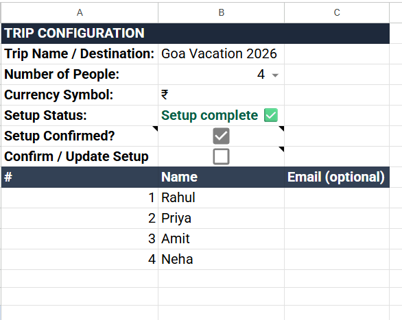
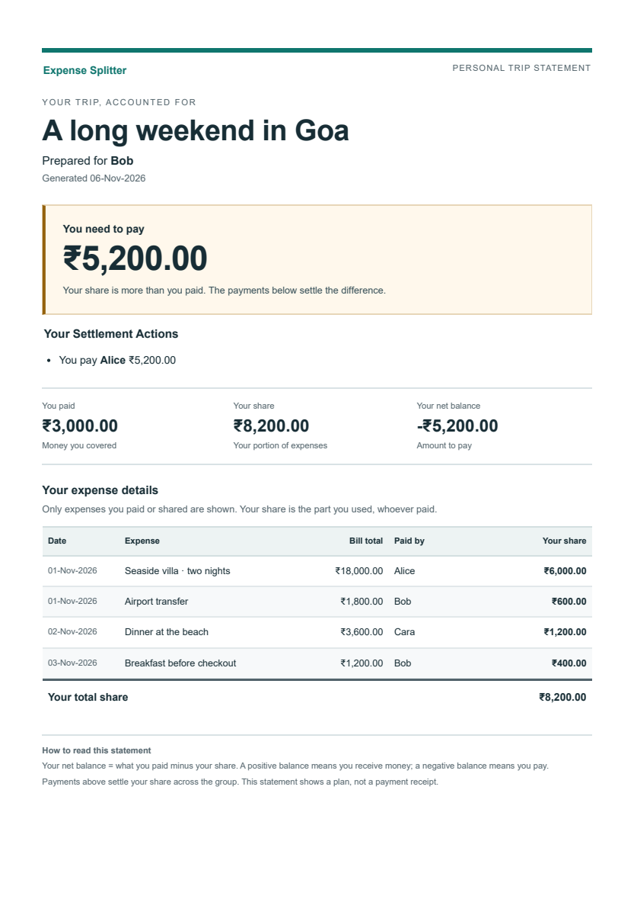
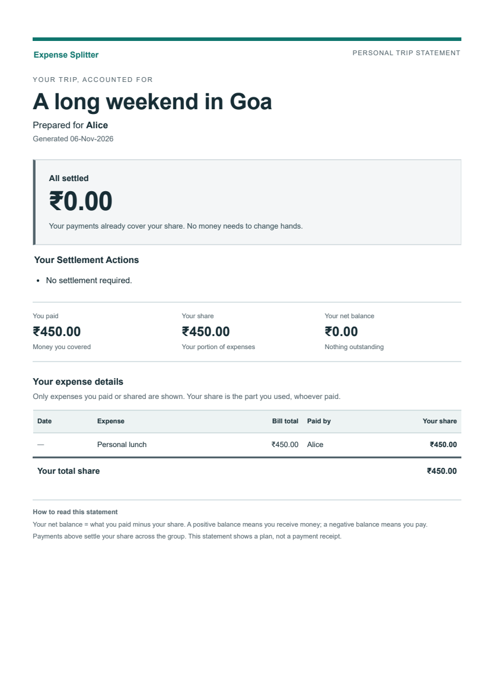
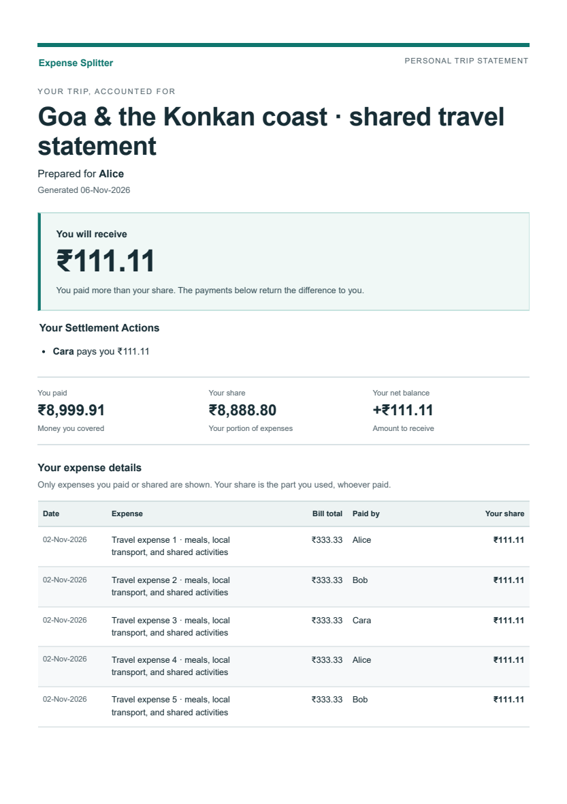

<div align="center">

# ✈️ Dynamic Group Travel Expense Splitter

**A zero-dependency, open-source Splitwise alternative built directly inside Google Sheets.**
Instant per-person split calculations, a live group summary panel, exact minimum-transfer settlements, and 1-click personalized PDF email reports.

[](#quick-start)
[](#quick-start)
[](LICENSE)
[](#contributing)

<br />

<a href="#quick-start">
  
</a>

<br /><br />

[**🚀 Click Here to Make a Copy in Google Drive**](https://docs.google.com/spreadsheets/d/11dY2B2j1dNIRlWfagUtbX13LRmW894mhnhCGBVsx9oQ/copy)
*(No installation required for non-technical users)*

</div>

---

## 🌟 Why Use This Over Splitwise?

* **Self-Hosted in Google Sheets:** No application subscription or ads. Supports up to 15 people and 500 expense rows per tracker; Google service quotas still apply.
* **Instant Live Calculations:** Per-person split columns compute the moment you type an expense — no confirm step, no waiting, just like a native spreadsheet formula.
* **Live Summary Panel:** A persistent dashboard beside your entries always shows the **Total Spent (Everyone)**, each person's **Spent (Share)** — what they technically consumed even if they paid nothing — and their **Net Balance** (+ collect / − owe).
* **Exact Settlement Engine:** On confirmation, uses subset dynamic programming to find the fewest possible transfers for up to 15 people. Every settlement row explains the outstanding debt, credit, and payment amount.
* **Automated PDF Email Statements:** Generates clean, personalized HTML/PDF expense reports — each person receives only the expenses that involve them — dispatched via Gmail in one click.
* **Dynamic Roster Scaling:** Scale your group seamlessly from 2 to 15 people — the grid, dropdowns, person columns, and summary panel auto-adjust on the fly.
* **Mobile Editing & Confirmation:** Enter expenses and confirm setup through checkboxes in the Sheets app. Send PDF emails from the desktop menu or Apps Script editor.

---

## 📸 Screenshots & Workflow

### 1. Trip & Roster Setup



### 2. Expense Tracker & Live Summary


### 3. Simplified Settlements


### 4. Generated Participant PDF

<table width="100%">
  <tr>
    <td width="50%" align="center" valign="top">
      <b>Receive money</b><br /><br />
      <a href="assets/pdf-report.png"></a>
    </td>
    <td width="50%" align="center" valign="top">
      <b>Pay money</b><br /><br />
      <a href="assets/pdf-report-pay.png"></a>
    </td>
  </tr>
  <tr>
    <td width="50%" align="center" valign="top">
      <b>All settled</b><br /><br />
      <a href="assets/pdf-report-settled.png"></a>
    </td>
    <td width="50%" align="center" valign="top">
      <b>Long statement — first page</b><br /><br />
      <a href="assets/pdf-report-long.png"></a>
    </td>
  </tr>
</table>

*PNG screenshots from the rendered [test previews](tests/preview-pdf.cjs), using fictional trip data. Click any image to view it at full size.*

---

<a id="quick-start"></a>

## ⚡ Quick Start

Use a Google account with permission to edit your own spreadsheet copy. Node.js and clasp are only needed for local development.

**Initialize only on a fresh copy:** `setup()` / `1. Initialize / Reset Tracker` clears the **Setup**, **Expenses**, and **Send Reports** sheets. Updating script code does not require running initialization again.

### Option A: 1-Click Google Sheet Template (Easiest)
1. Click the **[Make a Copy Template Link](https://docs.google.com/spreadsheets/d/11dY2B2j1dNIRlWfagUtbX13LRmW894mhnhCGBVsx9oQ/copy)**.
2. Open the newly created spreadsheet in your Google Drive.
3. Reload the spreadsheet to load the **Expense Splitter** menu, then select `1. Initialize / Reset Tracker` on the fresh copy.
4. Authorize the script when prompted, then follow **Daily workflow** below. If the menu is missing, open **Extensions → Apps Script** and run `setup()` once.

### Option B: Manual Setup via Google Apps Script
1. Create a blank **Google Sheet**.
2. Navigate to **Extensions** → **Apps Script**.
3. Replace all content in `Code.gs` with the code from [`Code.js`](Code.js).
4. In Apps Script **Project Settings**, enable the manifest editor and copy [`appsscript.json`](appsscript.json) into the project's `appsscript.json` to match the V8 runtime and timezone.
5. Save, select `setup` in the function dropdown, and click **Run** to initialize the blank sheet and authorize the script.
6. Reload Google Sheets to load the **Expense Splitter** menu, then follow the workflow below.

### Daily workflow

1. Fill in the trip name, participant count, currency symbol, and unique participant names on **Setup**. Emails are optional. Use names without commas so subgroup selections remain unambiguous.
2. Select **Expense Splitter → Confirm / Update Setup**, or tick `Setup!B6` / `Setup!B7` on mobile.
3. Enter expenses in **Expenses!A2:E501**. Choose a payer and leave **Split Among** blank for everyone, or enter names such as `Rahul, Neha`.
4. When ready to review, select **Confirm All Expenses** and open **Send Reports**. On mobile, tick `Setup!B6`; if already checked, clear it and tick it again to refresh.
5. To send statements, use **3. Send PDF Reports via Email** on desktop and grant email permission if requested. Review delivery status in **Send Reports**.

Confirmation is a report-visibility gate, not an edit lock: expense edits continue to recalculate the plan. Changing setup details resets confirmation. After renaming or removing participants, update their names in existing **Paid By** and **Split Among** entries before reconfirming.

---

## 🧭 The Three Tabs

### 1️⃣ Setup
Configure the trip and the group:

| Cell | Setting | Default |
|------|---------|---------|
| `Setup!B2` | Trip Name / Destination | Goa Vacation 2026 |
| `Setup!B3` | Number of Participants (dropdown 2–15) | 4 |
| `Setup!B4` | Currency Symbol | ₹ |
| `Setup!B5` | Setup Status (auto-validated) | — |
| `Setup!B6` | **Setup Confirmed?** checkbox; also gates settlement/report output | ☐ FALSE |
| `Setup!B7` | **Confirm / Update Setup** checkbox action; resets after use | ☐ FALSE |
| `Setup!A9:C…` | Roster: `#` · `Name` · `Email (optional)` — rows scale with B3 | — |

> Emails are **optional** — only people with an email address receive PDF reports; everyone else is cleanly skipped and logged.

### 2️⃣ Expenses
Enter expenses in columns **A–E**; everything else is computed live:

| Column | Field | Type |
|--------|-------|------|
| A | Date | Date-validated (dd-mmm-yyyy) |
| B | Description | Free text |
| C | Amount | Currency-formatted |
| D | Paid By | Dropdown, auto-filled from roster |
| E | Split Among | `All`, blank, or comma-separated names |
| F+ | *One column per person* | Net for that expense: amount paid minus personal share; + collect / − owe |
| **K–N** | **LIVE SUMMARY panel** | Person, Paid, Spent (Share), Net (4-person roster; position shifts with group size) |

**LIVE SUMMARY example:** Priya pays a ₹10,000 bill split equally among four people. Total Spent (Everyone) is ₹10,000:

| Person | Paid | Spent (Share) | Net (+ collect / − owe) |
|--------|-----:|--------------:|-----------------------:|
| Rahul | ₹0 | ₹2,500 | −₹2,500 |
| Priya | ₹10,000 | ₹2,500 | +₹7,500 |
| Amit | ₹0 | ₹2,500 | −₹2,500 |
| Neha | ₹0 | ₹2,500 | −₹2,500 |

**Duo example:** if Person 2 pays a ₹1,000 hotel bill split between both, the summary shows **Spent ₹500** for each person. Person 1's net is **−₹500** and Person 2's net is **+₹500**. The generated expense-row columns show those signed nets, not the ₹500 shares.

### 3️⃣ Send Reports
Available when `Setup!B6` (**Setup Confirmed?**) is checked. Use **Confirm All Expenses** to refresh the report after reviewing expenses. It shows:

* **Personal Balances Summary** — per-person Total Paid, Total Share, Net Balance, and email delivery status.
* **Simplified Settlement Plan** — the minimum set of "X pays Y ₹amount" transactions that settles the whole group.

---

## ⚙️ How It Works

### Supported inputs & delivery

- Supports **2–15 participants** and **500 expense rows**, starting at row 2. Rows after 501 are not included in calculations.
- Enter positive amounts with up to two decimal places. Empty/incomplete rows and non-positive or non-numeric amounts are ignored; refunds and negative expenses are not supported.
- Names match without case sensitivity or surrounding spaces. Duplicate subgroup names count once. Unknown subgroup names are ignored if a valid name remains; a split with no valid names blocks settlement.
- The currency field changes the displayed symbol only; it does not convert amounts between currencies.
- Sending reports is manual. Missing or invalid email addresses are skipped. Running the send action again sends another email to every valid address, including participants already marked **Sent**.
- PDF conversion and email sending use your Google account's [Apps Script quotas](https://developers.google.com/apps-script/guides/services/quotas).

### Equal & Partial Splits
* **"All" or blank Split Among:** cost splits equally across the whole roster.
* **Comma-separated names** (`Rahul, Neha`): cost splits only within that subgroup.
* **Remainder handling:** leftover whole paisa/cents are distributed one at a time by ascending participant ID among the included people. Shares add up to the original amount, and group balances reconcile to zero.

### Settlement Engine (Exact Minimum Transfers)
The solver finds the largest number of independent groups whose net balances sum to zero. It then settles each group separately. If there are `n` people with nonzero balances and `g` groups, the minimum number of transfers is `n - g`.

```
Net balances → optimal independent groups → payments within each group
             → verify minimum transfer count and zero remaining balances
```

For debts of ₹8, ₹7, and ₹5 with credits of ₹12 and ₹8, the solver finds two groups: `(−₹8, +₹8)` and `(−₹7, −₹5, +₹12)`. It generates three transfers instead of the four produced by ungrouped greedy matching. The existing greedy helper is used only inside optimal groups, where it produces the required minimum.

The **Explanation** column beside each payment uses this template: “[Person A] owes ₹X. [Person B] needs ₹Y. Pay ₹[smaller of X or Y] so at least one person reaches ₹0 balance.” Names, outstanding amounts, and currency come from the actual payment plan. Payment order is deterministic, and PDF payment instructions use the same plan.

The exact solver uses `O(n × 2^n)` time and `O(2^n)` memory, with at most 32,768 subsets for 15 people. It blocks invalid balances, unsafe integer totals, and groups above the supported limit. It never substitutes an approximate plan. See the [design and decision log](docs/plans/optimal-settlements.md).

### Performance Design
* Expense inputs are read as a range and calculated in memory; participant results and summary rows are written in batches.
* Structural rebuilds (headers, dropdowns, validations) happen **only** on Setup/roster changes, never while typing expenses.
* The Send Reports sheet rebuilds only on confirm toggles and while confirmed.
* UI messages fall back from alerts to toasts or logs when dialogs are unavailable.

---

## 🧰 Menu Reference (Desktop)

| Menu Item | Action |
|-----------|--------|
| `1. Initialize / Reset Tracker` | Clears and rebuilds the three tracker sheets |
| `2. Recalculate Live Expenses` | Recalculates expense nets and live summary; refreshes reports when confirmed |
| `Confirm / Update Setup` | Validates the roster, rebuilds generated columns, and confirms setup |
| `Confirm All Expenses` | Publishes balances + settlement plan (assignable to a drawing button) |
| `Re-open for Editing (Unconfirm)` | Withdraws the report view |
| `3. Send PDF Reports via Email` | Emails personalized PDF statements to roster emails |
| `Test Email Permission` | Sends a test mail to verify the send-mail authorization |
| `Diagnose Settlement Data` | Shows roster, ledger errors, balance checks, and settlement rows |

> **Mobile users:** use `Setup!B6` or `Setup!B7` for confirmation. Email sending uses the desktop menu or the `sendPdfReports()` function in Apps Script.

---

## Local Development with clasp

Use Node.js 22+ and the [Google clasp CLI](https://github.com/google/clasp). There is no package manifest, build step, or local server.

```sh
npm install -g @google/clasp
clasp login
```

Enable the **Google Apps Script API** in [Apps Script user settings](https://script.google.com/home/usersettings). Create a development spreadsheet and open its bound script through **Extensions → Apps Script**. Copy its **Script ID** from **Project Settings** into the `scriptId` field of this checkout's `.clasp.json` before pushing, so uploads target your own development sheet.

Run these commands from the repository root:

```sh
node --check Code.js
node --test
clasp status
clasp push
clasp open-script
```

The first commands check syntax and run local tests. `clasp status` lists upload files; `clasp push` uploads to the configured project; `clasp open-script` opens its editor. The upload should contain `Code.js` and `appsscript.json`; `.claspignore` excludes tests and preview artifacts. Clasp authentication authorizes uploads; spreadsheet and email permissions are granted separately when running the script.

Run `setup()` only when initializing a blank development spreadsheet. For subsequent code updates, reload the sheet and use **2. Recalculate Live Expenses** or **Confirm All Expenses** as needed. Edit-trigger behavior, actual PDF conversion, and email delivery require checks in Google Sheets.

---

## 📂 Project Architecture

```
travel-expense-excel/
├── Code.js                   # Google Apps Script engine
├── appsscript.json           # Apps Script runtime settings
├── .clasp.json               # Apps Script project mapping
├── .claspignore              # Excludes local tests from uploads
├── AGENTS.md                 # Contributor guidelines
├── README.md                 # Project documentation
├── assets/                   # Setup, expenses, settlements, and PDF screenshots
├── docs/plans/               # Settlement design and decision log
└── tests/
    ├── calculations.test.cjs # Money, ledger, and sheet output tests
    ├── optimal-settlements.test.cjs # Exact minima, explanations, and benchmarks
    ├── settlements.test.cjs  # Settlement validity and minimum-count checks
    ├── pdf-report.test.cjs   # Personal statement content and privacy checks
    ├── preview-pdf.cjs       # Generates sample report HTML without sending email
    ├── helpers/              # Spreadsheet boundary mocks and exact test oracle
    └── README.md             # Test scope and known limitations
```

---

## Participant PDF Design

Each A4 statement starts with the trip and participant, followed by a prominent **You need to pay**, **You will receive**, or **All settled** amount. Exact payment instructions appear before the expense list. Three summary figures show money paid, personal share, and signed net balance.

Expense rows use right-aligned amounts, a bold personal share, alternating backgrounds, and repeating column headings on long reports. Only expenses the recipient paid or shared appear. The final total reconciles to their personal share. Text labels explain pay/receive states without relying on color.

Reports use a self-contained HTML template with system fonts and no external assets. The existing Apps Script PDF conversion and email flow use this template directly. Local Chromium samples verify layout; Apps Script conversion should also be checked in a development spreadsheet.

Generate pay, receive, settled, and long-statement HTML previews without sending email:

```sh
node tests/preview-pdf.cjs
```

Open the files in `tests/previews/` and print to PDF using A4 paper with browser headers and footers disabled. These files are excluded from clasp uploads. The repository includes sample preview artifacts; running the command regenerates HTML, not the committed PDF or PNG files.

---

## Automated Calculation Tests

Use Node.js 22 or newer. No npm dependencies or Google credentials are needed:

```sh
node --test
```

The tests execute the real `Code.js` in an isolated VM with an in-memory spreadsheet boundary. They cover exact totals, per-person shares and balances, remainder allocation, subgroup splits, invalid rows, generated spreadsheet values, and debt clearance. Exact minimum counts are checked against an independent exhaustive oracle on 625 small balanced cases and 200 seeded groups. Additional cases exercise 15 participants, 500 expense rows, explanation text, roster changes, and consistent spreadsheet/PDF payment instructions. The suite also reports a local 15-person solver benchmark.

See [`tests/README.md`](tests/README.md) for focused commands and limitations. `.claspignore` keeps local tests out of Apps Script uploads. Actual Google Sheets triggers, authorization, PDF generation, and email delivery still require manual checks.

---

## 🔧 Troubleshooting

| Symptom | Fix |
|---------|-----|
| Emails not sending | Run **Test Email Permission** and approve "Send email as you"; mails are sent from the account running the script |
| Expense rows missing from calculations | Check positive Amount + Paid By, valid names, and that the row is between 2 and 501 |
| Reports say unconfirmed or show old results | Reconfirm setup, then select **Confirm All Expenses** to rebuild the report |
| Unknown payer after changing the roster | Update old names in **Paid By** and **Split Among**, then reconfirm |
| Menu missing after a code update | Reload the spreadsheet; run `onOpen()` in Apps Script if necessary |
| Formatting or generated columns look wrong | Use **Confirm / Update Setup**, then **2. Recalculate Live Expenses** |
| Quota or authorization error | Read the Apps Script execution error, check account quotas, and authorize the required service |
| Something feels off | Run **Diagnose Settlement Data** and read the reported ledger errors |

---

<a id="contributing"></a>

## 🤝 Contributing

Contributions are welcome! Please feel free to open an issue or submit a pull request:

1. Fork the Repository.
2. Create your Feature Branch (`git checkout -b feature/AmazingFeature`).
3. Commit your Changes (`git commit -m 'Add some AmazingFeature'`).
4. Push to the Branch (`git push origin feature/AmazingFeature`).
5. Open a Pull Request.

Include a short behavior summary and validation results. Add screenshots when changing sheet layouts or PDF output; verify financial changes with `node --test`.

---

## 📜 License

Distributed under the MIT License. See [LICENSE](LICENSE) for more information.
