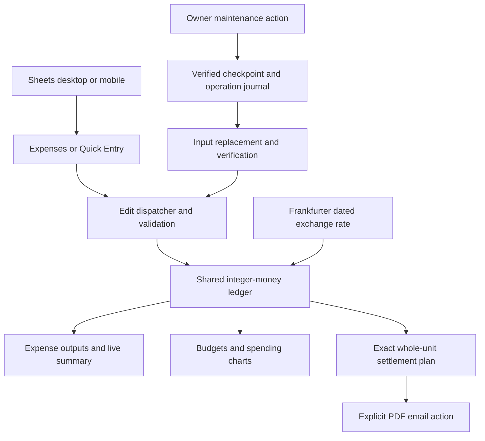

# Architecture and Function Reference

This reference describes the implementation in [Code.js](../Code.js). Start with the [README](../README.md) for setup and everyday workflows. Requirements and review history are in the [mobile design](plans/mobile-expense-workbook.md); local verification is recorded in the [implementation plan](plans/mobile-expense-implementation.md).

## Runtime and System Boundary

The application is a Google Apps Script V8 project bound to one spreadsheet. Its runtime files are Code.js, [TripJson.html](../TripJson.html), and [appsscript.json](../appsscript.json). There is no application server, external database, npm runtime dependency, or HTTP API to host.

Users edit native sheet cells or use the desktop menu. TripJson.html is an HtmlService dialog that downloads JSON in the browser or calls `importTripJson(json)` through `google.script.run`. Import does not send email or create a Drive download file. PDF conversion and MailApp delivery are separate, explicit actions.

Historical FX uses the requested currency pair and transaction date. Personal names, emails, and descriptions are not part of that request URL. Rates are stored with expiration metadata; the authoritative lifetime is 24 hours, with CacheService entries limited by `FX_CACHE_SECONDS` to six hours. Saved trips do not include the rate cache and can therefore fetch rates again.

## Workbook Modes

| Mode | Activation | Input layout | Generated participant output | Portable export |
| --- | --- | --- | --- | --- |
| Classic | Initialize a blank tracker with `setup()` | A:F: date, description, amount, payer, split, currency | G onward | Schema 2 |
| Upgraded | Owner explicitly runs `upgradeMobileWorkbook()` | A:G inputs; H stable Expense ID | I:W for at most 15 people | Schema 3 |

The original five-input-column layout is migrated to classic Currency F when rebuilt. That compatibility migration is separate from the owner-enabled mobile upgrade. Layout detection for version 3 requires the Category and Expense ID headers at G/H. Maintenance metadata prevents partially written headers from falling back into ordinary classic calculations while a replacement is unfinished.

### Sheet Responsibilities

| Sheet | Responsibility |
| --- | --- |
| Setup | Trip name, 2–15 participant count, base currency, confirmation controls, all 15 roster slots, active trip ID, and timezone selection |
| Expenses | Up to 500 input rows at 2–501; one generated net column per active participant |
| Send Reports | Always-live summary at H:K; confirmed personal balances and settlement instructions at A:F |
| Records | Latest saved portable JSON snapshot for each saved trip ID |
| Dashboard | Upgraded totals, excluded-row count, duplicates, advisory budgets, charts, and processing/recovery status |
| Quick Entry | Upgraded participant directory, 15 vertical draft blocks, template dropdowns, and copy/submit/reset controls |
| Budgets | Upgraded trip allowance, up to 100 category allowances, and explicit budget-currency review |
| History | Owner-only version selection/preview/restore, interrupted-operation recovery, and pending-request inspection/cancellation |
| _Tracker State | Application-managed chunked configuration, receipts, versions, indices, previews, and operation journal |

Upgraded warnings occupy Expenses X and acknowledgement checkboxes occupy Y. Full-row sorting must move A:Y together. Partial-column sorting cannot reliably preserve expense/category/ID associations and is unsupported. IDs are repaired for missing, duplicated, or cleared records; acknowledgements bind to identity and matching values rather than row position.

Quick Entry's first block starts at row 23 and blocks are 24 rows apart. Template headers are at row 386; the 50 editable rows are 387–436, columns A:F. Hidden rows inside each block hold the generation token, bound trip ID, and acknowledgement backing value. These are implementation metadata, not private user storage.

## Event Routing and Submission Flow

### Classic Edits

`onEdit(e)` handles ordinary local calculations. When `enableAutomaticFx()` registers the authorized dispatcher for that spreadsheet, limited simple edits defer to `onAuthorizedEdit(e)` to avoid double processing and permit cold FX fetches. Classic incomplete rows are omitted from the live ledger; row errors still prevent settlements/reports.

### Upgraded Edits

The owner installs `onAuthorizedEdit(e)` through `installWorkbookAutomation()`, including for local-currency trips. The simple handler returns without processing upgraded edits. The authorized path ignores installations whose effective account differs from the configured organizer, checks unfinished maintenance, and serializes actions with the document lock. [Google's trigger documentation](https://developers.google.com/apps-script/guides/triggers/installable) explains creator-account execution and why one account cannot enumerate another account's triggers.

For a guided submission:

1. Read the participant's draft and require its bound trip ID to match the active trip.
2. Validate roster, payer, positive amount, date, split, and currency. Templates leave amount blank; copied expenses remain drafts until explicitly submitted.
3. Persist a receipt containing request ID, draft generation/hash, original trip ID, immutable payload/hash, intended expense ID, target row, and phase.
4. Mark the receipt `writing` before the input write. Verify saved values by expense identity before marking it `committed`.
5. Write the saved acknowledgement, reset the action checkbox, and rotate the draft generation in one range update. Clear amount only when draft values still match the submitted values.
6. Recalculate the shared ledger/views and attempt a separate recovery checkpoint. Checkpoint failure does not turn a committed expense into an unsaved expense.

Receipt phases are `allocated`, `writing`, `committed`, and explicit `cancelled`. A retry that finds its verified expense reconciles it rather than appending another. A new acknowledged generation permits a deliberate identical bill, which remains subject to duplicate warnings. An ambiguous outcome with no verifiable expense is not blindly retried; the owner inspects it through History and can cancel the request without adding or deleting expenses.

## Calculation and Reporting Contracts

- `toMinor_()`, allocation helpers, and `buildLedger_()` calculate with integer minor units. All supported currencies currently use two decimal places, regardless of their usual currency precision.
- Equal, exact, percentage, and exclusion syntax share `parseSplitAmong_()`. Exact source totals are validated before historical conversion. Remainders follow deterministic participant ordering.
- Paid totals equal consumed totals; net balances sum to zero. Dashboard category/day totals use converted ledger amounts and count each valid expense once. Person consumption is separate from money paid.
- Upgraded nonempty incomplete rows remain visible and label partial totals. Row errors and unacknowledged duplicates block final confirmation; acknowledged duplicates and budget overruns do not remove expenses.
- Budget limits are optional and independent. Blank means no limit, zero means zero allowance, and overruns are advisory. A base-currency change suspends budget comparisons until explicit review.
- `buildWholeUnitLedger_()` derives balanced whole-unit payment balances from the exact ledger. `calculateOptimalSettlements_()` finds the minimum transfer count for the balanced ledger supplied to it, using subset dynamic programming bounded to 15 participants.
- Final sheet/PDF payment instructions use the same rounded payment ledger and deterministic plan. Raw expense data and dashboard spending retain minor-unit accounting; whole-unit settlement adjustments do not rewrite inputs.
- Sending reports is manual and repeatable, not deduplicated by prior Sent status. Only a participant's relevant expenses enter that participant's PDF. `testEmailPermission()` also sends a real message.

## Persistent Data Formats

### Portable Records

Records uses A:E for trip ID, name, UTC save time, nonempty input-row count, and JSON part count. F onward stores chunks of at most 40,000 JSON characters, prefixed `JSON:`. Chunking preserves UTF-16 surrogate pairs. This is distinct from the _Tracker State format below.

| Schema | Expense-row width | Other data |
| --- | --- | --- |
| 1, accepted import | 5: A:E | Trip identity, savedAt, timezone, setup, and all 15 roster slots |
| 2, classic export/import | 6: A:F | Adds row currency; blank inherits trip base |
| 3, upgraded export/import | 8: A:H | Adds category/unique ID and workbook categories, budgets, templates, and acknowledgement configuration |

The portable format identifier is `travel-expense-trip`. Dates are encoded as `{ "type": "date", "value": "<ISO timestamp>" }`. Interior blanks and incomplete expense inputs remain; trailing empty rows are omitted. Formulas are archived as current values and restored text is escaped when needed to avoid formula interpretation.

`validateTrip_()` validates the envelope and row widths. Version 3 additionally validates workbook configuration and unique, well-formed IDs. Imported files receive a fresh trip ID before loading. Upgraded legacy imports acquire inherited currency where needed, blank categories, and fresh IDs. Classic loading requires the existing timezone to match; upgraded loading applies the saved timezone during replacement and returns unconfirmed inputs.

### Recovery State

_Tracker State stores one logical value under an application key:

| Column | Meaning |
| --- | --- |
| A | State key |
| B | `PREPARING` candidate or `COMMITTED` value |
| C | SHA-256 checksum of serialized JSON |
| D | JSON chunk count |
| E onward | `JSON:`-prefixed chunks, each at most 40,000 JSON characters |

`workbookPut_()` stages a new row, reads chunks back, commits its marker, verifies it, then removes superseded committed rows for that key. Readers choose the latest committed row and verify its checksum. A candidate that failed verification never supersedes the old committed value. Do not manually edit state cells or treat this checksum as an immutable audit guarantee.

| Key | Stored value |
| --- | --- |
| `config:<tripId>` | Last valid categories, budgets/budget currency, templates, and duplicate acknowledgements |
| `receipt:<requestId>` | Durable submission receipt and phase |
| `draft:<slot>` | Current receipt association for a participant block |
| `version:<versionId>` | Raw recovery envelope, trip ID, version ID, timestamp, and reason |
| `versions:<tripId>` | Ordered version index; retention keeps the latest 20 after safe completion |
| `history-directory` | Trip IDs and shortened display names for browsing recovery history; original names remain in payloads |
| `checkpoint:<tripId>` | Last automatic checkpoint time, input fingerprint, and version ID |
| `operation` | Replacement journal, original protection metadata, target/before payloads, and phase |
| `preview` | Immutable source/version and destination binding for restoration |
| `request-preview` | Receipt/input binding for pending-request cancellation |

The internal recovery format is `travel-expense-recovery`, schema version 1. It preserves raw setup and expense drafts without requiring a valid participant count or valid editable timezone field. It also stores the actual spreadsheet timezone and last valid workbook configuration. Unsaved invalid budget/template edits and transient Quick Entry drafts are not a full edit-history backup. Recovery does not include FX cache or historical email delivery state.

### Document Properties and Cache

| Property | Purpose |
| --- | --- |
| `AUTOMATIC_FX_EDIT` | Spreadsheet ID identifying the authorized classic FX route; also set by upgraded installation |
| `WORKBOOK_ORGANIZER` | Effective organizer account for upgraded event routing |
| `WORKBOOK_OPERATION_PHASE` | Lightweight maintenance gate, set before journal mutation and cleared only after verified terminal state |
| `WORKBOOK_DASHBOARD_HEIGHT` | Prior generated dashboard footprint |
| `WORKBOOK_CHART_SHAPE` | Chart/table dimensions used to avoid unnecessary chart reconstruction |
| `FX_<from>_<to>_<date>` | Cached rate and expiration; expired FX entries can be removed without deleting other settings |

These are application-managed values, not environment variables. CacheService provides a shorter-lived copy of FX entries; persistent expiration remains authoritative. Do not clear an operation property to bypass recovery.

## Replacement, Recovery, and Permissions

`replaceWorkbook_()` journals `prepared`, `restricted`, `checkpointed`, `writing`, `verifying`, `cleanup`, and `complete` phases. Safe pre-write failures can terminate as `aborted`. The maintenance property remains conservative if journaling is interrupted.

Replacement requires the owner, an editing pause, temporary input restrictions, two consistent pre-write reads, a verified pre-replacement version, and verification of the intended written inputs. Valid current inputs are also saved in Records; invalid drafts remain recoverable through the raw History directory. Previews bind source and destination identities/fingerprints so an earlier confirmation cannot silently target a new selection.

`recoverWorkbookOperation()` preserves the current state first. It restores the before-payload for unverified writes, or completes UI/protection cleanup for phases whose inputs were already verified. It removes only temporary protections bearing that operation's identifier, preserving pre-existing protections. Failure leaves the journal and available checkpoints for another explicit recovery attempt.

Spreadsheet protections cannot exclude the owner/executing account. Document locks serialize scripts, not arbitrary direct edits; everyone must pause during maintenance. History and state are shared-workbook data, not private forms or a tamper-proof audit log. Deleting the entire spreadsheet is outside this recovery mechanism.

## Public Entry Points

| Function | Purpose / operational effect |
| --- | --- |
| `onOpen()` | Adds menu and non-destructive controls; avoids ordinary control refresh while maintenance is unfinished |
| `onEdit(e)` | Classic simple-trigger route; defers upgraded/maintenance processing |
| `onAuthorizedEdit(e)` | Authorized classic FX or upgraded dispatcher |
| `setup()` | Initializes/resets classic active sheets; upgraded workbooks use checkpointed New Trip |
| `upgradeMobileWorkbook()` | Owner-only opt-in migration or repair; installs upgraded automation |
| `installWorkbookAutomation()` | Owner registration/repair, protection setup, and safe pending-request reconciliation |
| `recoverWorkbookOperation()` | Explicit owner interrupted-operation recovery |
| `enableAutomaticFx()` | Classic FX installation; upgraded mode delegates to workbook automation repair |
| `recalculateAll(forceReports)` | Rebuilds live ledger, outputs, reports, and upgraded dashboard; unfinished maintenance blocks ordinary recalculation |
| `confirmSetupFromMenu()` / `confirmAllExpenses()` | Confirmation; upgraded mode applies shared row/duplicate gates |
| `unconfirmExpenses()` | Withdraws confirmation and rebuilds report visibility |
| `saveTrip()` | Latest Records snapshot; upgraded mode first creates a recovery version |
| `loadSelectedTrip()` / `newTrip()` | Replace active inputs after the applicable save/checkpoint safeguards |
| `downloadSelectedTrip()` / `showImportTrip()` | Desktop JSON dialogs; download uses the selected saved snapshot |
| `importTripJson(json)` | Validated dialog callback; assigns a new identity and replaces inputs without sending email |
| `deleteSelectedTrip()` | Confirms deletion of one Records archive; clears active identity if it matches |
| `sendPdfReports()` / `testEmailPermission()` | Explicit real email delivery |
| `diagnose()` | Ledger/settlement diagnostics; its Expected participant columns text still uses classic G-based positions |

Underscore-suffixed functions are implementation helpers, not a public HTTP API. See the [desktop menu reference](../README.md#menu-reference) and [mobile controls](../README.md#daily-phone-workflow) for user-facing invocation.

## Limits and Verification Boundaries

The supported calculation envelope remains 2–15 participants and 500 expenses. New configuration limits are 100 categories and 50 templates. Automatic checkpoints are throttled to at most one per five minutes after processed changes; there is no maximum recovery-lag guarantee or timer-based backup promise. Recovery retains 20 versions per trip, not an unlimited number of trips.

Capacity preflight checks grid growth against `WORKBOOK_MAX_CELLS` and the column limit. Large payloads, service quotas, and execution time can still stop processing. State writes reserve cleanup time by rejecting new writes after 240 seconds in the current invocation; that guard does not guarantee execution or cleanup under all failures. Mandatory checkpoint failure blocks replacement rather than truncating inputs or deleting another trip.

Deleting the active Records row clears Setup!E3. Because upgraded configuration is keyed by trip ID, a later new identity receives default configuration while the former configuration/history remains under the old ID. Preserve the export or restore that former trip through History when needed.

Local tests model services, protections, formulas, charts, and lock contention. They do not prove actual Google permissions, native-app rendering/links, trigger delivery, cold FX latency, or PDF conversion. Consult the [test boundaries and release checks](../tests/README.md#mobile-workbook-tests-and-release-checks) before production use.
